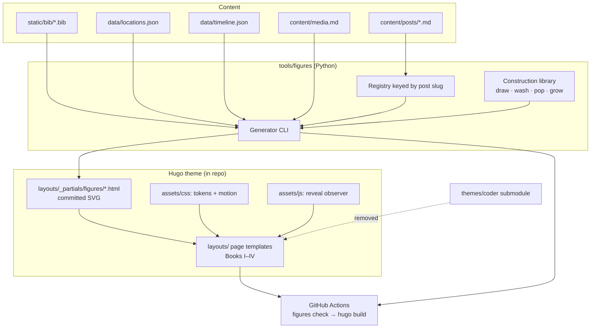

# ADR-0009: Byrne's Euclid Redesign on an In-Repo Theme with Generated Figures

**Date**: 2026-10-30
**Status**: Accepted
**Status history**: Proposed 2026-10-30 → Accepted 2026-10-30
**Deciders**: Alex Djalali
**Supersedes**: [ADR-0001](0001-blog-design-white-black-academic-theme.md)
**Related**: [ADR-0002](0002-standard-blog-features.md), [ADR-0003](0003-timeline-components-and-ui-refinements.md), [ADR-0004](0004-publication-abstract-toggle.md), [ADR-0005](0005-publication-and-site-wide-ui-refinements.md), [ADR-0007](0007-geo-aeo-enhancements.md), [ADR-0008](0008-404-rss-series-responsive-enhancements.md)

## Context

The site runs on the Hugo Coder theme (git submodule `themes/coder`) restyled per ADR-0001. The repo already carries 35 template files under `layouts/` that override or extend Coder, and `assets/css/custom.css` has grown to about 3,500 lines. The primary menu has eight entries (Posts, Projects, Resume, Publications, Talks, Media, Gear, About). Posts are listed as plain year/month text with no imagery.

A design exploration produced a new visual system, reviewed on a Claude design canvas ("Blog Redesign Wireframes", Full site page, 15 artboards). Its north star is Oliver Byrne's 1847 colour edition of Euclid:

- **Palette:** red, yellow, blue, black and white only.
- **Type:** light-weight IBM Plex.
- **Figures:** geometric constructions with watercolour-edged fills.
- **Structure:** posts as numbered propositions, the bio as postulates, sections as Books.

Each post carries a figure drawn from its own argument. For example, "Rethinking Agile" plots the essay's build-vs-stable table on a log scale, and "100 Patterns" draws its 16 parts as 100 cells. Figures assemble themselves with CSS animation.

Three things block implementing this on the current stack:

- **Coder's stylesheet:** it still ships underneath the overrides, so every new rule competes with inherited ones.
- **Figure generation:** Hugo templates cannot run the geometry the figures need. Examples: chords between all quorum nodes, lattice layouts, and parsing BibTeX into a per-year histogram.
- **Navigation:** the eight-item menu has no place for the four-Book structure.

## Decision

1. **In-repo theme.**
   - Remove the `themes/coder` submodule, its `.gitmodules` entry, and `theme = "coder"` from `hugo.toml`. `layouts/` becomes a complete theme: `baseof.html`, header, footer, and every page type.
   - `assets/css/custom.css` is replaced by a new stylesheet built from the tokens below. `.github/workflows/hugo.yml` no longer checks out submodules.
2. **Design tokens.**
   - **Colours:** `#D62718` red, `#F5C400` yellow, `#1F4E9E` blue, `#111111` black, `#FFFFFF` white. No other hues.
   - **Fonts:** IBM Plex Sans 200/300/400 for display, Plex Serif 300/400 for body, Plex Mono 400 for labels. Loaded from Google Fonts, which the existing CSP already allows (`fontsrc`, `stylesrc` in `hugo.toml`).
   - **Light only:** the colour-scheme toggle and every dark-mode branch are removed. The five-colour palette has no dark variant.
   - **Icons:** the Font Awesome CSS and fonts the site uses are vendored from Coder into `assets/css/fontawesome.css` and `static/fonts/`.
3. **Information architecture.**
   - The primary menu becomes four Books: I. Writing (`/posts/`), II. Research (`/publications/`, sub-nav Talks `/presentations/`), III. Projects (`/projects/`), IV. About (`/about/`, sub-nav Resume `/cv/`, Media `/media/`, Gear `/gear/`, AI disclosure `/ai-disclaimer/`). Existing URLs do not change, so no redirects are needed.
   - Templates derive each post's proposition numeral from its chronological rank. A post's `description` renders as its "To prove:" line.
4. **Generated figures.**
   - A Python package at `tools/figures/` (uv, ruff, basedpyright, pytest) holds a registry keyed by post slug. It writes one SVG partial per post under `layouts/_partials/figures/`.
   - It also writes the data-driven figures: the research histogram from `static/bib/*.bib`, the homes line from `data/locations.json`, and the career lanes from `data/timeline.json`. Research counts reach Hugo through the generated `data/figures/research.json`.
   - The lifeline and career lanes are the no-JS and reduced-motion view of the About and Resume timelines; the interactive D3 timelines (ADR-0003) replace them when JS is on.
   - Media keeps its real cover images; the canvas's hashed covers were placeholders.
   - A post without a registry entry gets a default construction derived from its slug.
   - It also renders the raster outputs: one PNG social card per post (`static/images/og/<slug>.png`), `og-default.png`, the favicon PNGs and `favicon.ico`, all drawn from the same figures and the red-triangle mark. Rendering uses `resvg-py` with only the fonts vendored in `tools/figures/fonts/` (IBM Plex Sans, Serif and Mono, and Noto Sans Math for logic symbols, under the SIL OFL), so a card looks the same on every machine. Card text (site name, host, the definition and its label, and the posts Book's kicker) comes from `hugo.toml`; post titles come from front matter.
   - Output is committed. CI runs `uv run figures check`, which regenerates in memory and fails when any committed file differs from, or is missing from, the generator's output, or when a stale card has no post. Text files are compared byte for byte; each PNG is compared by a digest stamped into it, covering its SVG, sizes, the vendored fonts and the resvg version, because resvg output can differ by a few pixels between CPUs.
5. **Motion.**
   - Figure parts carry animation classes (draw, bloom, pop, grow, fade); headlines rise word by word.
   - A small script adds an `is-revealed` class through `IntersectionObserver`, so figures assemble as they scroll into view.
   - `prefers-reduced-motion: reduce` disables all animation. No animation depends on CSS scroll-timeline support.
6. **Retained features.** Timelines (ADR-0003), publication abstract toggles (ADR-0004), giscus comments, JSON-LD and meta tags (ADR-0007), and the 404, RSS and series behaviour (ADR-0008) carry over into the new templates with the new styling.

## Alternatives Considered

| Alternative | Pros | Cons |
|-------------|------|------|
| Keep Coder and override on top | No submodule removal; smaller first diff | Coder's CSS and partials keep fighting the new design; `custom.css` grows further; upstream theme updates can break overrides silently |
| Compute figure SVG in Hugo templates from front-matter params | No Python step in the build | Go templates have no trig helpers beyond basics and no BibTeX parsing; quorum chords, lattices and histograms become unmaintainable template code |
| Hand-drawn static SVG per post | Simplest pipeline | Every new post needs manual drawing; data-driven figures (publications, timeline, homes) drift from their data with no check |
| Generate figures at runtime in the browser (e.g. D3) | Figures update without a build step | Adds a JS dependency and render cost on every page view; figures absent without JS; breaks the no-heavy-JS character of the site |
| Spectral, Fraunces, or Jost type sets | All tested on the canvas | Plex reads as engineered and mathematical at light weights and gives sans, serif and mono from one family |
| Self-host the Plex fonts | No third-party font request | More files to manage; the CSP already allows Google Fonts and the site already uses it |

## Architecture Diagram

## Consequences

### Positive
- One stylesheet with no inherited theme rules; the 35 override files collapse into one theme the repo owns.
- Figures encode each post's argument and cannot drift from the data they plot: CI regenerates them on every push.
- The menu drops from eight entries to four, and every existing URL stays the same.

### Negative
- Publishing a post now has a second step: add a registry entry and run the generator, or accept the default construction.
- The build gains a Python toolchain (uv) in CI alongside Hugo.
- The repo carries about 1.6 MB of vendored fonts for the raster cards, and bumping `resvg-py` or a font marks every card stale until it is regenerated.
- Every page template is rewritten. Coder's own fixes and features no longer arrive by updating the submodule.

### Risks
- **Watercolour filters:** `feTurbulence` displacement filters on many figures per page (the Writing index shows 11) may cost paint time on low-end phones. Mitigation: share one filter set per page, and cap filtered figures in list views if profiling shows jank.
- **Retained features:** carrying over the ADR-0003/0004/0007/0008 behaviour into new templates can drop a feature unnoticed. Mitigation: a checklist of retained features verified against the built site before cutover.
- **Contrast:** yellow `#F5C400` fails text contrast on white. It is restricted to fills and never used for text on white.

## Implementation Notes

- **Order:**
  1. Tokens, base layout and the Coder removal.
  2. The figure generator with its registry and CI drift check.
  3. Book I: home, writing index with topic filter, article, search, 404.
  4. Book II: research, talks.
  5. Book III: projects.
  6. Book IV: about, resume, media, gear, AI disclosure.
  7. Motion and the reduced-motion path.
- **Testing:**
  - **pytest for the generator:**
    - Output is deterministic for a fixed input.
    - The registry covers every post in `content/posts/`, or the post falls back to the default.
    - Data invariants hold: the "100 Patterns" part sizes sum to 100, and the patent count matches the BibTeX files.
  - **CI:** `hugo --minify` builds cleanly.
  - **Browser checks:** the built site is verified against the canvas at 1280 px and 390 px, and `prefers-reduced-motion` is checked to disable animation.
- **Rollback:** the redesign merges as one PR; reverting the merge commit restores Coder, the submodule entry and the old layouts.
- **Docs:** `README.md` (structure, features, theme), plus a section in it on adding a figure for a new post.
